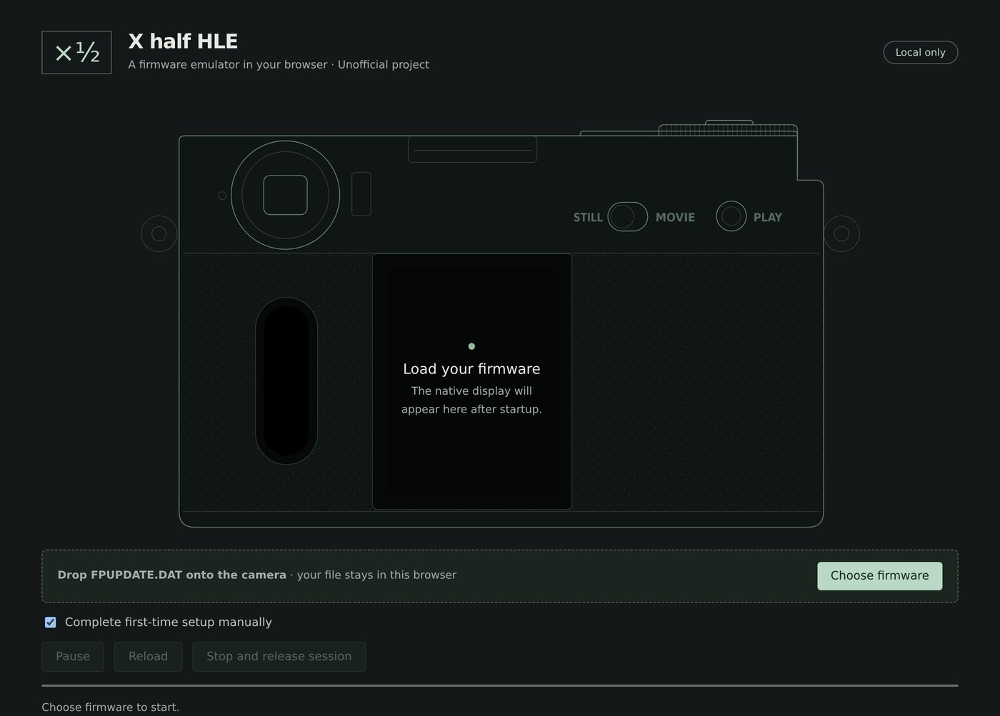

# X half HLE

Run native ARM firmware, ThreadX and the camera's original menus in your browser. This is an unofficial project. You supply your own complete `FPUPDATE.DAT`; the file is processed locally and is never uploaded or saved by the app.

[Open the app](https://xndcn.github.io/xhalf-hle/)



## Use

Open the app in desktop Chrome or Edge, then drop your firmware file onto the page or choose it with the file picker. The app validates the package and boots the firmware from scratch. First-time setup is skipped through native firmware events; select **Complete first-time setup manually** before loading to perform it yourself.

Click and drag the firmware display to navigate. Arrow keys, Enter and Esc work where the firmware supports camera buttons; some menus support touch only. Additional shortcuts are M for the menu, 1–7 for categories, Tab to skip setup, and B/C for the screen's back/confirm actions. On-screen buttons provide the same shortcuts.

Pause, resume, stop or reload a session using the controls below the display. Settings changes last only for the session and do not modify the original file. The app pauses when the page loses focus or becomes hidden.

Only the official firmware version 2.0 is supported, identified by [the supported profile](src/profiles/xhalf-main.json). Unknown versions are rejected before execution. Real sensor imaging, photo/video encoding and camera networking are outside the current implementation. The language inside the emulated display is controlled by the firmware's own settings.

## Development

Use Node.js 24 or later. The Wasm build also requires Python 3, CMake 4.0.2, a C compiler, Git, tar and curl.

```sh
npm ci
python3 -m pip install cmake==4.0.2
npm run wasm:build
npm run check
npm run dev
```

For browser tests:

```sh
npx playwright install chromium
npm run test:e2e
```

Public tests use synthetic data and independently written ARM fixtures. Real firmware tests are explicitly skipped unless private inputs are configured. See [private testing](docs/PRIVATE-TESTING.md) and [benchmark methodology](docs/BENCHMARK.md). Build resources resolve beneath the `/xhalf-hle/` GitHub Pages path.

## Technical documentation

- [Architecture](docs/ARCHITECTURE.md) and [native IRQ/GIC](docs/GIC.md)
- [Hooks and hardware boundaries](docs/HOOKS.md)
- [Virtual block storage](docs/STORAGE.md)
- [Firmware profiles](docs/PROFILE-SCHEMA.md) and [new firmware adaptation](docs/FIRMWARE-ADAPTATION.md)
- [Reproducible Wasm builds](docs/WASM-BUILD.md)
- [Sources and licenses](docs/LICENSES.md)

Original project code is MIT licensed. The combined Unicorn/Unicorn.js runtime is distributed under its upstream GPL terms, with the required license and corresponding source materials. Firmware, extracted resources and native GUI screenshots are not distributed; the README screenshot shows only the app's own shell before any firmware is loaded.
